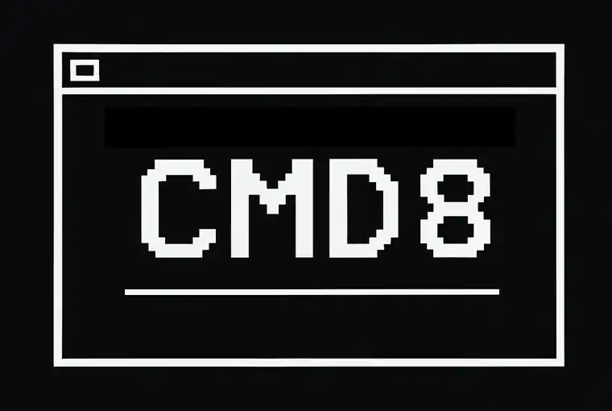
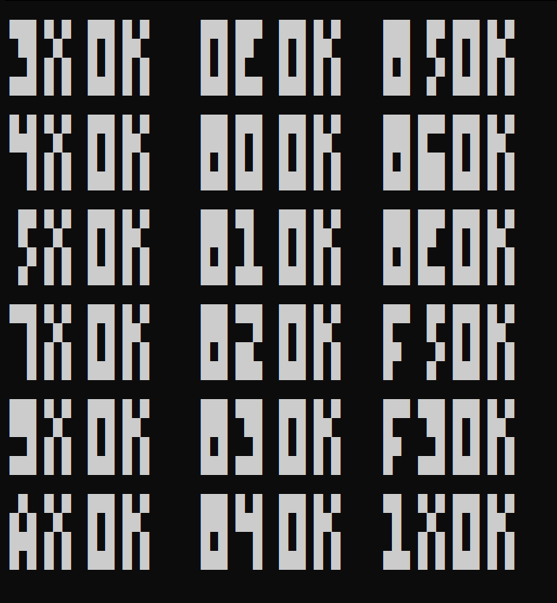
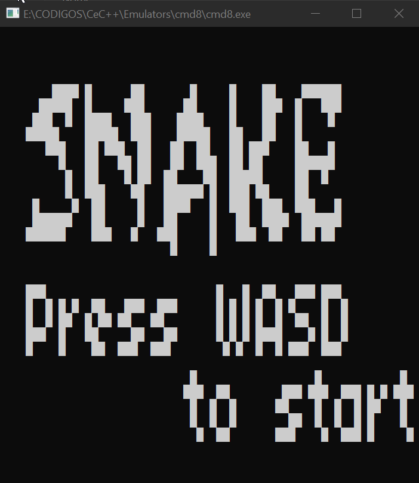

<h1 align="center">
  <br>
  CMD8
  <br>
</h1>
<div align="center">

</div>
<h4 align="center">Emulador de chip8 feito em C++ usando o Prompt de Comando (cmd)</h4>

## 💻 Info:

<div align="center">


</div>

Emulador de CHIP-8 (e compativeis) desenvolvido em C++ rodando diretamente no Prompt de Comando (cmd) do Windows.

## 🧪 Roms testadas

- Chip-8
  - [3-corax+.ch8](https://github.com/Timendus/chip8-test-suite)
  - [4-flags.ch8](https://github.com/Timendus/chip8-test-suite)
  - [5-quirks.ch8](https://github.com/Timendus/chip8-test-suite)
  - [6-keypad.ch8](https://github.com/Timendus/chip8-test-suite)
  - [7-beep.ch8](https://github.com/Timendus/chip8-test-suite)
  - [test_opcode.ch8](https://github.com/corax89/chip8-test-rom/)
  - [pong.rom](https://github.com/badlogic/chip8/tree/master/roms) (Com extensão .ch8)
  - [invaders.rom](https://github.com/badlogic/chip8/tree/master/roms) (Com extensão .ch8)
  - [1dcell.ch8](https://johnearnest.github.io/chip8Archive/roms/1dcell.ch8)
  - SI.ch8
  - [IBM_Logo.ch8](https://github.com/loktar00/chip8/tree/master/roms)
  - 16AD.ch8
- Chip-8X
  - [ColourTest.c8x](https://github.com/etxmato/emma_02/tree/master/data/Chip-8/Chip-8X)
  - [SoundTest.c8x](https://github.com/etxmato/emma_02/tree/master/data/Chip-8/Chip-8X)
  - [Blockout [Steve Houk].c8x](https://github.com/etxmato/emma_02/tree/master/data/Chip-8/Chip-8X)
- SuperChip-8 (Parcial, lowres)
  - [snake.ch8](https://johnearnest.github.io/chip8Archive/roms/snake.ch8) (RPL Flags)


## 🎮 Controles

🎮 Keypad 1:

| P | A | D | 1 |
|---|---|---|---|
| 1 | 2 | 3 | 4 |
| Q | W | E | R |
| A | S | D | F |
| Z | X | C | V |

🎮 Keypad 2:

| P | A | D | 2 |
|---|---|---|---|
| 6 | 7 | 8 | 9 |
| Y | U | I | O |
| H | J | K | L |
| N | M | , | . |


🎮 Outros:

P = Fecha o programa

## 👨‍🏫 Usando:

Compilando:
```
make
```

Rodando:
```
cmd8.exe <rom_file.ch8>
```
